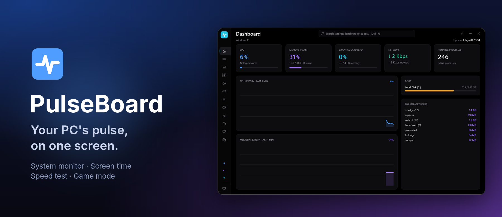
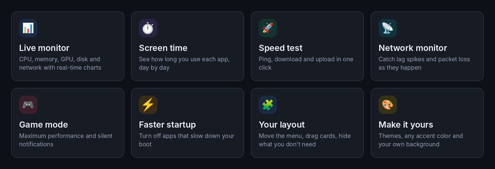
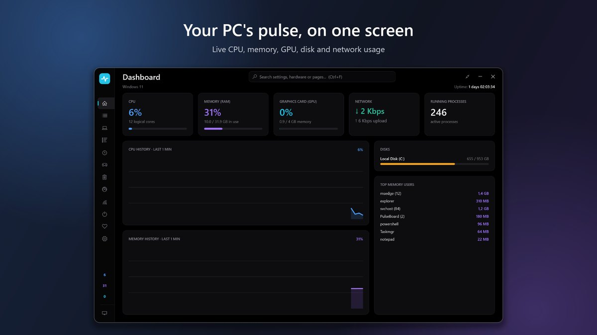
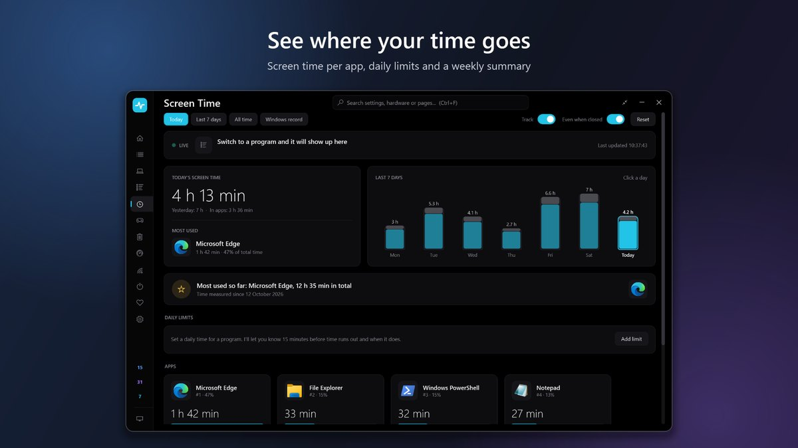
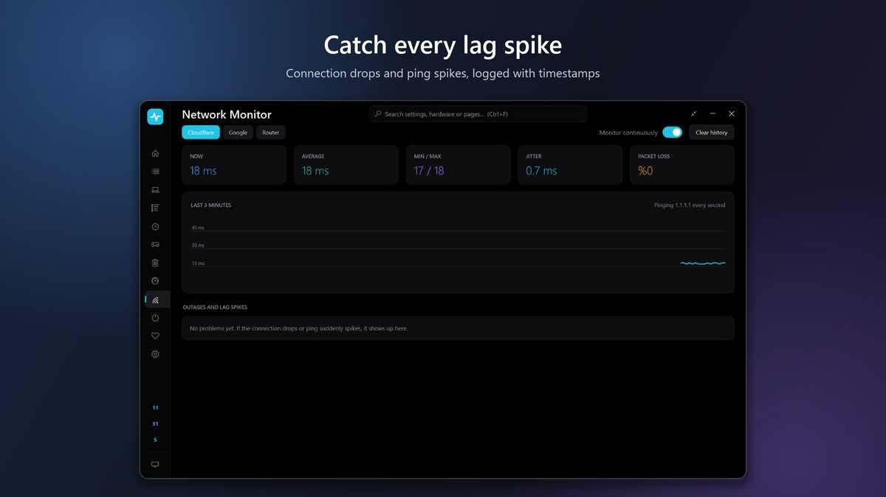
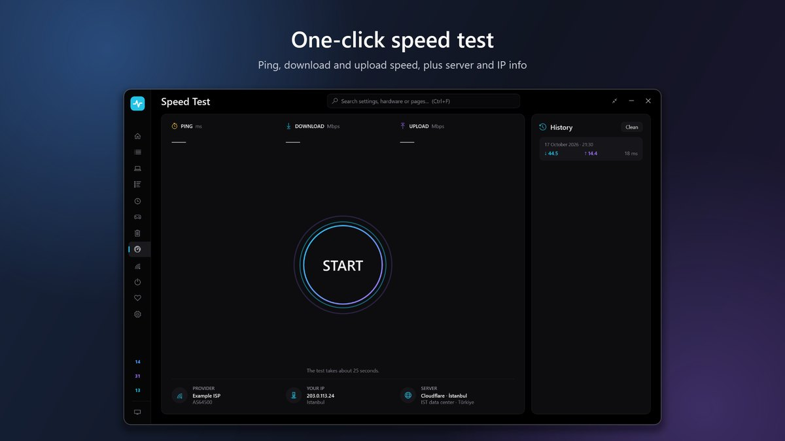
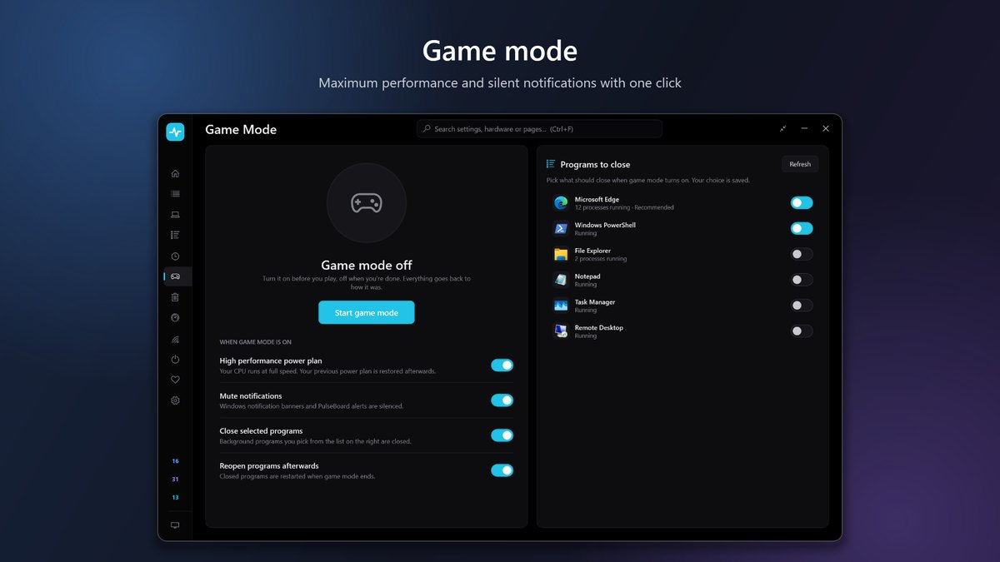
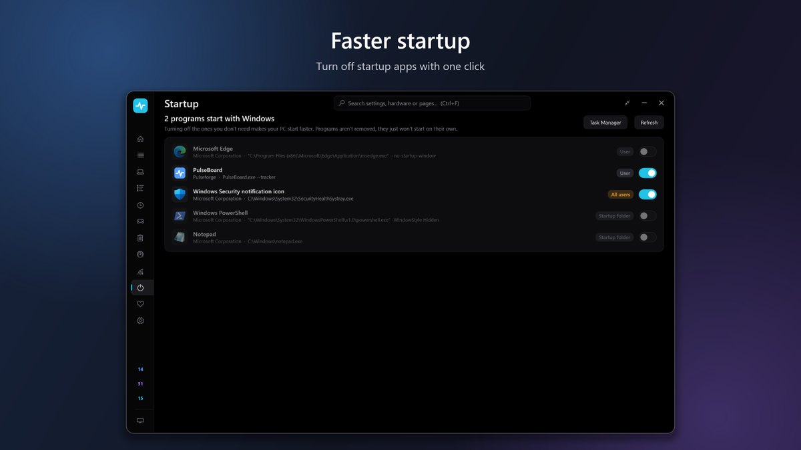
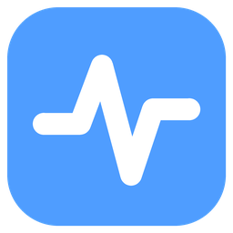

  

  

  
  
  
  

 

## ✨ Highlights

  

 

## 📸 A closer look

<table>
  <tr>
    <td width="50%"></td>
    <td width="50%"></td>
  </tr>
  <tr>
    <td width="50%"></td>
    <td width="50%"></td>
  </tr>
  <tr>
    <td width="50%"></td>
    <td width="50%"></td>
  </tr>
</table>

 

## 📥 Get PulseBoard

**[Download it free from the Microsoft Store →](https://apps.microsoft.com/detail/9N3MJ375R1GJ)**

One click to install, updates arrive automatically, nothing else to download.
Works on Windows 10 (version 2004 or later) and Windows 11.

## 🔒 Privacy

PulseBoard doesn't collect, sell or share your data. Everything it measures stays on your PC.
Read the full [privacy policy](https://nabinla.github.io/PulseBoard/privacy.html).

## 💬 Feedback

Found a bug or have an idea? In PulseBoard, go to **Settings → About → Report a problem**, or [open an issue](https://github.com/nabinla/PulseBoard/issues/new).

 

   
  Made by <b>Pulseforge</b> · © 2026

